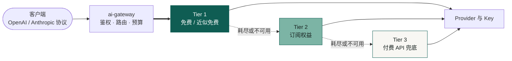

<div align="center">

# ai-gateway

**基于 Cloudflare Workers 的高韧性 AI API 网关**

把分散在不同 Provider、API Key、额度与模型别名上的容量，汇成 **一个稳定的 OpenAI / Anthropic 兼容入口**

[](https://github.com/fongap-labs/ai-gateway/actions/workflows/ci.yml)
[](LICENSE)


[快速开始](#快速开始) · [配置](#配置) · [文档](#文档) · [参与贡献](#参与贡献) · [安全](#安全)

</div>

<p align="center">
  <a href="https://api.135468.xyz/"></a>
</p>

<p align="center"><sub>上图为维护者真实生产实例的近实时数据，由网关自身渲染。</sub></p>

## 这是什么

ai-gateway 是一个**私有**的 AI API 网关，运行在 Cloudflare Workers 上，面向**家庭、个人运营者或小型可信团队**。你把手里零散的模型容量接进来，客户端只需要一个地址和一把网关密钥。

> 可以把它想象成**多路插线板**：几家的电源（模型容量）插进来，某一路断了自动切到下一路，你的电器只插一个插口。



| 适合 | 不适合 |
| --- | --- |
| 手里有多个免费额度或多把 Key，想统一调用 | 公共 SaaS、对外售卖 API |
| 个人或小团队自托管，想同时控制成本与稳定性 | 计费、转售、按用户计量 |
| 同时使用 OpenAI 与 Anthropic 协议的客户端 | 企业级组织、RBAC、多租户 |

## 支持的协议与可靠性

| 能力 | 当前行为 |
| --- | --- |
| 协议 | OpenAI Chat Completions、OpenAI Responses（仅原生）、Anthropic Messages；Chat ↔ Messages 有界互转 |
| 容量顺序 | Tier 1 免费 → Tier 2 订阅 → Tier 3 付费兜底，严格按序使用 |
| 限流与故障 | 429 自适应冷却后单次探测恢复；模型 404 只隔离失败的映射 |
| 重试与回退 | 所有尝试共享一套预算，`max_attempts` 为硬上限；流式输出开始后不再切换上游 |

细节见 [架构概览](docs/architecture/overview.md)、[协议模型](docs/architecture/protocol-model.md) 与 [可靠性模型](docs/architecture/reliability-model.md)。

## 快速开始

网关本身是一个 **Cloudflare Worker**，安装脚本会把它部署到你的 Cloudflare 账户下。

### 开始前

- **Node.js** ≥ 22.18.0（版本以 `package.json` 为准）
- **Cloudflare 账户**
- **至少一个上游 Key** 或订阅，否则网关无法转发请求

### 部署

```bash
git clone https://github.com/fongap-labs/ai-gateway.git
cd ai-gateway
npm ci
sh scripts/install.sh          # Windows: powershell scripts/install.ps1
```

安装脚本会依次提问，然后完成配置并部署。每个问题怎么回答，展开下面的说明：

<details>
<summary>安装脚本会问什么</summary>

| 步骤 | 你需要提供 | 说明 |
| --- | --- | --- |
| 1 | Worker 名称 | 直接回车使用默认值 |
| 2 | KV 命名空间 ID | 在 Cloudflare 控制台创建一个 KV 命名空间，复制它的 ID |
| 3 | 节点配置文件（JSON） | Tier 1 必填，Tier 2、3 可留空；可参考 `config/tier1-nodes.example.json` |
| 4 | 节点凭据文件（JSON） | 形如 `{ "节点 id": "上游 Key" }`，只保存在本机，不要提交到 Git |
| 5 | 网关访问密钥 | 每个分组一把，至少一组。生成方式：`node -e 'console.log(require("crypto").randomBytes(32).toString("base64"))'` |
| 6 | 网关公网地址 | `https://` 开头 |

脚本会自动生成订阅 token 的加密密钥，无需手动填写。

</details>

### 验证部署

```bash
curl https://<你的网关>/health -H "Authorization: Bearer <YOUR_GATEWAY_KEY>"
curl https://<你的网关>/v1/models -H "Authorization: Bearer <YOUR_GATEWAY_KEY>"
```

`/v1/models` 列表为空，通常是该分组的模型允许列表没有配置，见 [配置](#配置)。

### 接入客户端

客户端的 base URL 指向网关，密钥换成网关访问密钥。模型名使用**逻辑模型名**（如 `code-pro`）。

```bash
# OpenAI 协议（Chat Completions / Responses）
OPENAI_BASE_URL=https://<你的网关>/v1
OPENAI_API_KEY=<YOUR_GATEWAY_KEY>

# Anthropic 协议（Messages，例如 Claude Code）
ANTHROPIC_BASE_URL=https://<你的网关>
ANTHROPIC_AUTH_TOKEN=<YOUR_GATEWAY_KEY>
```

### 第一次调用

```bash
curl https://<你的网关>/v1/chat/completions \
  -H "Authorization: Bearer <YOUR_GATEWAY_KEY>" \
  -H "Content-Type: application/json" \
  -d '{"model": "code-pro", "messages": [{"role": "user", "content": "你好"}]}'
```

## 配置

网关的行为由下面四类变量决定：

| 变量 | 作用 | 存放位置 |
| --- | --- | --- |
| `AIG_TIER{1,2,3}_NODES_01..10` | 节点定义：provider、地址、模型映射 | 普通变量 |
| `AIG_TIER{1,2,3}_CREDENTIALS_01..10` | 上游凭据，按节点 id 绑定 | Secret |
| `AIG_ACCESS_KEY_{AIR,PRO,MAX,ULTRA,AGENT}` | 网关访问密钥 | Secret |
| `AIG_ACCESS_MODELS_{AIR,PRO,MAX,ULTRA,AGENT}` | 该分组允许调用的逻辑模型 | 普通变量 |

`01..10` 只是分片编号。配置分片与凭据分片彼此独立（independent），凭据按 **Tier + node id** 绑定到节点，不按相同的后缀对应。

- 五个访问分组互不继承；模型列表为空，该分组就**不能调用任何模型**。
- 凭据绝不写入节点配置。

节点格式、Tier 2 订阅接入与完整变量清单见 [配置文档](docs/operations/configuration.md)。

## 文档

| 想了解 | 去这里 |
| --- | --- |
| 架构、请求流程与模块职责 | [架构概览](docs/architecture/overview.md) |
| 路由、冷却与协议细节 | [路由模型](docs/architecture/routing-model.md) · [可靠性模型](docs/architecture/reliability-model.md) · [协议模型](docs/architecture/protocol-model.md) |
| 配置、订阅与变量清单 | [配置](docs/operations/configuration.md) |
| 部署、回滚与故障排查 | [部署](docs/operations/deployment.md) · [故障排查](docs/operations/troubleshooting.md) |
| 产品边界与治理规则 | [产品策略](docs/governance/product-policy.md) · [治理索引](docs/governance/README.md) |
| 术语解释 | [术语速查](docs/README.md#术语速查) |

所有文档的入口见 [docs/README.md](docs/README.md)。

## 参与贡献

完整规则见 [CONTRIBUTING.md](CONTRIBUTING.md)。

- 人类文档使用中文；PR 标题与 CHANGELOG 使用英文。
- 行为、配置、协议或部署变化，必须在同一 PR 中更新规范文档。
- 提交前运行 `npm run validate:merge`。PR 按 `.github/pull_request_template.md` 填写，使用 Squash merge。

## 安全

- 上游凭据只存于 Cloudflare Secret，不写入节点配置、日志或诊断输出。
- 网关密钥通过 `Authorization: Bearer` 或 `x-api-key` 头传递，不要放进 URL。
- `/health`、`/metrics` 与 `/v1/*` 都需要鉴权。
- 发现漏洞请走 GitHub 私密报告（Security → Report a vulnerability），不要开公开 Issue。完整规则与限流边界见 [SECURITY.md](SECURITY.md)。

## License

MIT License，详见 [LICENSE](LICENSE)。
