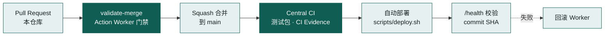

<div align="center">

# ai-gateway

**基于 Cloudflare Workers 的高韧性 AI API 网关**

把分散在不同 Provider、API Key、额度与模型别名上的容量，汇成 **一个稳定的 OpenAI / Anthropic 兼容入口**

[](https://github.com/fongap-labs/ai-gateway/actions/workflows/ci.yml)
[](LICENSE)


[快速开始](#快速开始) · [工作原理](#工作原理) · [配置](#配置) · [API](#api) · [文档](#文档地图) · [安全](#安全) · [维护者参考](#维护者参考)

</div>

<p align="center">
  <a href="https://api.135468.xyz/"></a>
</p>

<p align="center"><sub>上图为维护者真实生产实例的近实时数据，由网关自身渲染，并非合成的基准测试。</sub></p>

## 阅读路径

| 你的目标 | 从这里开始 |
| --- | --- |
| 第一次了解 ai-gateway | [这是什么](#这是什么)、[解决什么问题](#解决什么问题) |
| 看不懂某个词 | [术语速查](#术语速查) |
| 想先把它跑起来 | [快速开始](#快速开始) |
| 要配置节点、访问分组或订阅 | [配置](#配置) |
| 想理解路由与可靠性 | [工作原理](#工作原理)、[文档地图](#文档地图) |
| 参与开发、部署或维护 | [维护者参考](#维护者参考) |

## 这是什么

ai-gateway 是一个**私有**的 AI API 网关。你把手里零散的模型容量接进来，客户端只需要一个地址和一把网关密钥，就能调用全部容量。它运行在 Cloudflare Workers（边缘无服务器运行环境）上，面向**家庭、个人运营者或小型可信团队**，不是公共服务。

> **可以这样理解**：它像一个**多路插线板**。你把几家的电源（模型容量）插进来，插线板按顺序供电；某一路断了就自动切到下一路。你的电器（客户端）只需要插一个插口。


| 角色 | 含义 |
| --- | --- |
| **客户端** | 使用 OpenAI 或 Anthropic SDK、Claude Code 等工具的程序 |
| **Provider** | 模型服务商，例如 OpenAI、Anthropic 或各类兼容平台 |
| **Key** | 某个 Provider 的上游 API 密钥；同一家可以有多把 |
| **网关密钥** | 你发给客户端的访问密钥（`AIG_ACCESS_KEY_*`），与上游 Key 完全分离 |

| 适合 | 不适合 |
| --- | --- |
| 手里有多个免费额度或多把 Key，希望统一调用 | 公共 SaaS、对外售卖 API |
| 个人或小团队自托管，想同时控制成本与稳定性 | 计费、转售、按用户计量 |
| 同时使用 OpenAI 与 Anthropic 协议的客户端 | 企业级组织、RBAC、多租户控制平面 |

> 产品边界以 [产品策略](docs/governance/product-policy.md) 为准。

## 术语速查

第一次接触时，遇到不熟悉的词可以先查这里。表格按“先通用、后项目专有”排列。

| 术语 | 含义 |
| --- | --- |
| **SDK** | 软件开发工具包，例如 OpenAI SDK、Anthropic SDK，用来在代码里调用 AI 接口 |
| **Worker（Cloudflare Worker）** | 运行在 Cloudflare 边缘节点上的小程序，ai-gateway 本身就是一个 Worker |
| **Secret / 普通变量** | 在 Cloudflare 中配置网关的两种方式：Secret 加密保存、写入后无法再次读取，用于密钥；普通变量保存不敏感的配置 |
| **D1 / KV** | Cloudflare 的 SQLite 数据库 / 键值存储，分别用于用量数据与会话亲和 |
| **Tier** | 容量层级：Tier 1 免费、Tier 2 订阅、Tier 3 付费 |
| **节点（Node）** | 一个上游账号或端点的配置单元 |
| **逻辑模型** | 客户端看到的模型名（如 `code-pro`），映射到各节点的真实上游模型名 |
| **访问分组** | `AIR`、`PRO`、`MAX`、`ULTRA`、`AGENT` 之一，决定网关密钥可调用的逻辑模型 |
| **原生（Native）** | 与客户端同协议的上游路径，是网关的首选 |
| **回退（Fallback）** | 当前候选失败后，转向下一个候选、另一协议或兼容模型 |
| **Hedge（对冲请求）** | 主请求在约定延迟内仍未提交时，并行发出的备份请求（默认 3 秒） |
| **TTFT** | Time To First Token，首个 token 到达所用的时间 |
| **P2C** | Power of Two Choices，随机取两个候选、比较综合评分后择一的负载均衡算法 |
| **亲和（Affinity）** | 同一会话尽量回到同一账号的软性偏置 |
| **isolate** | Worker 的一个运行实例；网关的短期状态只保存在 isolate 内 |
| **PKCE** | OAuth 授权码流程的防截获扩展，订阅接入使用它 |

## 解决什么问题

真实的 AI 容量很零散：额度不同、同一家有多把 Key、模型会被限流后又恢复、两种协议的接口也不完全一样。普通反向代理解决不了这些问题，ai-gateway 在资源池外层补上**有界**的调度与可靠性控制。

| 常见问题 | ai-gateway 的处理方式 |
| --- | --- |
| 免费额度触发限流（429） | 自适应冷却，到期后单次探测，确认恢复再放量 |
| 某个模型映射失效（404） | 只隔离失败的节点与模型映射，不影响同节点的其他模型 |
| 客户端协议与上游不一致 | OpenAI Chat Completions ↔ Anthropic Messages 有界互转 |
| 流式输出中途切换上游，客户端收到断裂内容 | 有意义的输出提交后，不再透明切换上游 |
| 重试与回退把请求量成倍放大 | 所有 attempt、hedge 与墙钟时间共享一套预算，`max_attempts` 为硬上限 |
| 付费容量被无谓消耗 | Tier 3 只作为受保护的最终兜底，不用来弥补本可避免的 Tier 1 不稳定 |

## 工作原理

### 设计原则

| 原则 | 含义 | 在本项目中的体现 |
| --- | --- | --- |
| Tier 1 持续可用优先 | 日常流量以免费容量为主，韧性优先 | 自适应冷却、单次探测恢复、P2C 与被动 TTFT 调度 |
| 有界而非无界 | 重试、回退与对冲都有明确上限 | `max_attempts` 硬上限；兼容家族最多两轮；hedge 共享预算 |
| 协议边界不掩盖 | 只承诺真实支持的转换 | Chat ↔ Messages 有界互转；Responses 仅原生；流式不透明切换 |
| 默认收紧 | 缺省不授权 | 模型允许列表为空，即该分组不能调用任何模型 |
| 一套当前契约 | 不保留已退役的配置与兼容垫片 | 节点只认当前 schema；被替代的路径直接删除 |

### 容量分层

Tier 决定请求先走哪一类容量。三层**严格按序**使用：Tier 1 耗尽或不可用才看 Tier 2，Tier 2 之后才是 Tier 3。

| Tier | 容量类型 | 角色 | 设计重点 |
| --- | --- | --- | --- |
| **Tier 1** | 免费或近似免费的 API 容量 | 日常主力 | 韧性、负载分散、429 恢复、持续可用 |
| **Tier 2** | 订阅权益（Claude Pro/Max、ChatGPT/Codex、Google AI Premium，经 OAuth 接入） | 次级容量 | 订阅适配器；不是第二个通用 Key 池 |
| **Tier 3** | 付费 API 容量 | 受保护的最终兜底 | 可预测、有界、易于推理 |

### 一次请求的生命周期


三步共享同一个 `max_attempts`（请求级硬上限）与墙钟时间预算，任何一步都无法放大它。`/v1/responses` 只走原生路径，不参与第 ② 步。

| 约束 | 含义 |
| --- | --- |
| 原生优先 | 先用与客户端同协议的节点，耗尽后才做跨协议回退 |
| 有界回退 | 兼容模型家族最多两轮评估，不存在无界循环 |
| 流式安全 | 有意义的输出提交后，不再切换上游 |
| 亲和只是偏置 | 带 `x-session-id` 的会话优先回到同一账号，但不会绕过冷却或资格检查 |

## 快速开始

ai-gateway 本身就是一个 **Cloudflare Worker**。安装脚本会把它部署到你的 Cloudflare 账户下，部署完成后用一个网址就能调用。

### 开始前

- **Node.js** ≥ 22.18.0（版本以 `package.json` 为准）
- **Cloudflare 账户**
- **至少一个上游 Key** 或订阅，否则网关无法转发请求

### 部署

```bash
git clone https://github.com/fongap-labs/ai-gateway.git
cd ai-gateway
npm ci
sh scripts/install.sh          # Windows: powershell scripts/install.ps1
```

安装脚本会依次问你几个问题，然后完成配置并部署。每个问题怎么回答，展开下面的说明：

<details>
<summary>安装脚本会问什么</summary>

| 步骤 | 你需要提供 | 说明 |
| --- | --- | --- |
| 1 | Worker 名称 | 直接回车使用默认值 |
| 2 | KV 命名空间 ID | 在 Cloudflare 控制台创建一个 KV 命名空间，复制它的 ID |
| 3 | 节点配置文件（JSON） | Tier 1 必填，Tier 2、3 可留空；可参考 `config/tier1-nodes.example.json` |
| 4 | 节点凭据文件（JSON） | 形如 `{ "节点 id": "上游 Key" }`，只保存在本机，不要提交到 Git |
| 5 | 网关访问密钥 | 每个分组一把，至少配置一组。可用下面的命令生成：`node -e 'console.log(require("crypto").randomBytes(32).toString("base64"))'` |
| 6 | 网关公网地址 | `https://` 开头 |

脚本会自动生成订阅 token 的加密密钥，无需手动填写。

</details>

### 验证部署

```bash
curl https://<你的网关>/health -H "Authorization: Bearer <YOUR_GATEWAY_KEY>"
curl https://<你的网关>/v1/models -H "Authorization: Bearer <YOUR_GATEWAY_KEY>"
```

`/health` 返回健康诊断，`/v1/models` 列出这把密钥可以用的模型。如果模型列表为空，通常是该分组的模型允许列表没有配置，见 [访问分组](#访问分组)。

### 接入客户端

把客户端的 base URL 指向网关，密钥换成网关访问密钥。模型名使用**逻辑模型名**（例如 `code-pro`），而不是上游的真实模型名。

```bash
# OpenAI 协议（Chat Completions / Responses）
OPENAI_BASE_URL=https://<你的网关>/v1
OPENAI_API_KEY=<YOUR_GATEWAY_KEY>

# Anthropic 协议（Messages，例如 Claude Code）
ANTHROPIC_BASE_URL=https://<你的网关>
ANTHROPIC_AUTH_TOKEN=<YOUR_GATEWAY_KEY>
```

仪表盘首页（`/`）的快速开始区域会按你的分组生成同样的配置，可以直接复制。

### 第一次调用

```bash
curl https://<你的网关>/v1/chat/completions \
  -H "Authorization: Bearer <YOUR_GATEWAY_KEY>" \
  -H "Content-Type: application/json" \
  -d '{"model": "code-pro", "messages": [{"role": "user", "content": "你好"}]}'
```

`model` 必须是这把密钥所在分组允许的逻辑模型名。

遇到问题，先查 [故障排查](docs/operations/troubleshooting.md)。

## 配置

### 配置来源

| 变量 | 作用 | 存放位置 |
| --- | --- | --- |
| `AIG_TIER{1,2,3}_NODES_01..10` | 节点定义：provider、地址、模型映射 | 普通变量 |
| `AIG_TIER{1,2,3}_CREDENTIALS_01..10` | 上游凭据，按节点 id 绑定 | Secret |
| `AIG_ACCESS_KEY_{AIR,PRO,MAX,ULTRA,AGENT}` | 网关访问密钥 | Secret |
| `AIG_ACCESS_MODELS_{AIR,PRO,MAX,ULTRA,AGENT}` | 该分组允许调用的逻辑模型 | 普通变量 |
| `AIG_POLICIES_CONFIG` | attempt、hedge、超时与 Tier 1 准入策略（可选） | 普通变量 |

`01..10` 只是分片编号。配置分片与凭据分片彼此独立（independent），凭据按 **Tier + node id** 绑定到节点，不按相同的后缀一一对应。完整的变量清单见 [配置文档](docs/operations/configuration.md)。

### 节点与凭据

节点描述一个账号或端点；凭据单独存放。

```json
[
  {
    "id": "nvidia-01",
    "provider": "nvidia",
    "base_url": "https://integrate.api.nvidia.com/v1",
    "priority": 10,
    "models": { "Code-Max": "upstream-code-model" }
  }
]
```

| 字段 | 必填 | 说明 |
| --- | --- | --- |
| `id` | 是 | 节点唯一标识，小写字母、数字与连字符 |
| `provider` | 是 | 决定协议：`anthropic` → Messages，`openai` → Chat 与 Responses，其余 → OpenAI 兼容 Chat |
| `base_url` | 是（订阅节点可省略） | 必须是 HTTPS 地址 |
| `models` | 是 | 逻辑模型 → 上游模型的映射 |
| `priority` | 否 | 静态优先级，仅 Tier 2、3 使用；Tier 1 的调度忽略它 |

凭据文件只包含节点 id 与密钥的对应关系：

```json
{ "nvidia-01": "<UPSTREAM_API_KEY>" }
```

> 凭据绝不写入节点配置。节点配置中出现的凭据字段会被直接拒绝。

### 访问分组

- 五个分组（`AIR`、`PRO`、`MAX`、`ULTRA`、`AGENT`）互不继承，各自拥有一把密钥和一份模型列表。
- 模型列表为空或缺失，意味着该分组**不能调用任何模型**，包括 `AGENT`。
- 分组只决定能调用哪些逻辑模型，不参与 Tier 1 的调度评分。

### Tier 2 订阅接入

订阅节点让你把自己的 Claude、ChatGPT/Codex 或 Google AI 订阅作为 Tier 2 容量使用。凭据不写进配置，而是通过 OAuth（PKCE 授权码流程）接入，token 加密后存入 D1。

```json
{
  "id": "claude-sub-1",
  "provider": "anthropic",
  "auth": "oauth",
  "models": { "Code-Max": "upstream-code-model" }
}
```

| 步骤 | 操作 |
| --- | --- |
| 1 | 在 Tier 2 节点中声明 `"auth": "oauth"`，不配置静态凭据 |
| 2 | 用网关访问密钥打开 `/oauth/start?provider=<名称>&node=<节点 id>` 并完成授权 |
| 3 | Claude 与 Codex 自动回调完成；Google 需要把页面给出的授权码粘贴回网关 |
| 4 | 网关以 AES-GCM 加密保存 token，调度时按需解析，并在过期前自动刷新 |

> **运营风险**：订阅节点以供应商自家命令行客户端的身份调用其订阅端点，可能违反该供应商的服务条款，供应商也可能对账号限流、暂停或封禁。是否启用由运营者自行决定并承担风险。设置 `AIG_IS_SUBSCRIPTION_ENABLED=false` 可整体关闭该功能。详见 [SECURITY.md](SECURITY.md#订阅代理与-provider-条款)。完整示例见 [配置 - Tier 2 订阅](docs/operations/configuration.md#tier-2-订阅oauth)。

## API

| 方法 | 路径 | 协议 / 用途 | 鉴权 |
| --- | --- | --- | --- |
| `POST` | `/v1/chat/completions` | OpenAI Chat Completions | 网关密钥 |
| `POST` | `/v1/responses` | OpenAI Responses（仅原生） | 网关密钥 |
| `POST` | `/v1/messages` | Anthropic Messages | 网关密钥 |
| `POST` | `/v1/messages/count_tokens` | Anthropic 兼容的本地近似 Token 计数 | 网关密钥 |
| `GET` | `/v1/models` | 当前分组可见的模型目录 | 网关密钥 |
| `GET` | `/health` | 健康诊断，可按分组限制 | 网关密钥 |
| `GET` | `/metrics` | 运行时指标，可按分组限制 | 网关密钥 |
| `GET` | `/` | 公开仪表盘 | 公开，可用 `AIG_PUBLIC_DASHBOARD=false` 关闭 |

## 运行与边界

项目目前处于**稳定期**：除非真实生产数据证明存在结构性问题，否则不再调整架构。日常关注的是下面这些真实信号：

| 信号 | 为什么看 |
| --- | --- |
| 真实 429 | 判断 Tier 1 的冷却与恢复机制是否跟得上 |
| fallback / hedge 放大 | 确认重试与对冲没有把请求量成倍放大 |
| D1 写入量 | 控制用量统计的存储与写入成本 |
| TTFT（首 token 延迟） | 发现长尾延迟与被降权的节点 |

已知边界如下：

| 边界 | 实际行为 |
| --- | --- |
| 全局限流 | 内置 RPM 限流只在单个 Worker 实例内生效，并按分组计算。需要严格的全局限流时，在 Cloudflare WAF 中叠加 Rate Limiting |
| Provider 全局配额 | 网关不宣称跨实例一致的上游额度；自适应状态只在实例内尽力而为，实例重启即清空 |
| 用量数据 | D1 中的 token 用量属于可观测性数据，不参与路由决策 |

## 文档地图

| 你想了解 | 去这里 |
| --- | --- |
| 系统边界、请求流程与模块职责 | [架构概览](docs/architecture/overview.md) |
| 路由、回退与 Tier 1 调度 | [路由模型](docs/architecture/routing-model.md) |
| 失败分类、冷却与恢复 | [可靠性模型](docs/architecture/reliability-model.md) |
| 协议转换与流式边界 | [协议模型](docs/architecture/protocol-model.md) |
| 订阅适配器契约 | [订阅模型](docs/architecture/subscription-model.md) |
| 配置项与变量清单 | [配置](docs/operations/configuration.md) |
| 生产部署与回滚 | [部署](docs/operations/deployment.md) |
| 故障排查 | [故障排查](docs/operations/troubleshooting.md) |
| 本地运维脚本 | [scripts/README.md](scripts/README.md) |
| 产品范围与治理规则 | [产品策略](docs/governance/product-policy.md) · [治理索引](docs/governance/README.md) |
| 参与贡献 | [CONTRIBUTING.md](CONTRIBUTING.md) |
| 报告安全问题 | [SECURITY.md](SECURITY.md) |

## 安全

- 上游凭据只存放在 Cloudflare Secret 中，不写入节点配置、日志或诊断输出。
- 客户端的 `Authorization` 与 cookie 不会转发到上游；上游默认只允许 HTTPS，重定向不携带凭据。
- 网关密钥通过 `Authorization: Bearer` 或 `x-api-key` 头传递，请勿放入 URL 查询参数。
- `/health`、`/metrics` 与 `/v1/*` 都需要鉴权。发现漏洞请使用 GitHub 私密报告（Security → Report a vulnerability），不要开公开 Issue。

完整规则见 [SECURITY.md](SECURITY.md)。

---

## 维护者参考

> 以下内容面向维护者与贡献者。只使用网关的读者可以跳过。

### 治理边界

本仓库继承 Fongap Labs 的[共享治理](https://github.com/fongap-labs/action-worker/tree/main/docs)。业务规则留在本仓库，共用的执行与门禁交给 Action Worker。

| 归本仓库 | 归 Action Worker |
| --- | --- |
| 产品源码 `src/`、D1 迁移 `migrations/`、配置示例与运维脚本 `scripts/` | 命名、变更分类与 PR 门禁 |
| 架构、运营与产品策略文档 `docs/` | 合并权限 `validate-merge`、中央 CI 与测试包 `tests/packs/ai-gateway/` |
| 部署清单 `.github/deploy.json` 与部署入口 `scripts/deploy.sh` | 部署执行、Main Write Guard、凭据与 Environment 绑定 |

### 一次变更的旅程



- 合并权限只属于 `validate-merge`。
- 自动部署只在 `main` 的中央 CI 成功后运行（`.github/deploy.json` 中 `automatic: true`）。
- 部署标识是 commit SHA，经认证的 `/health` 暴露。项目发布编号由维护者人工通过 Git tag 或 GitHub Release 创建，文档与 CI 不生成。

### 本地检查

| 命令 | 作用 |
| --- | --- |
| `npm run validate:merge` | 合并前的本地门禁：语法、部署配置、迁移、密钥扫描、文档与链接、lint、类型检查 |
| `npm run check:deploy` | Worker 产物的 dry-run，不会部署到生产 |

### 参与贡献

完整规则见 [CONTRIBUTING.md](CONTRIBUTING.md)，下面是最需要先知道的几条：

| 项目 | 规则 |
| --- | --- |
| 语言 | 人类文档使用中文；PR 标题、工程 diff 与 CHANGELOG 条目使用英文 |
| 分支 | 使用 `feat/`、`fix/`、`refactor/`、`docs/`、`test/`、`ci/`、`chore/` 前缀，每个 PR 只有一个主要目标 |
| 规范文档 | 行为、配置、协议或部署发生变化，必须在同一 PR 中更新对应文档 |
| PR 描述 | 按 `.github/pull_request_template.md` 的目标、变更、验证、影响四段填写 |
| 合并 | 只使用 Squash merge |

## License

MIT License，详见 [LICENSE](LICENSE)。
