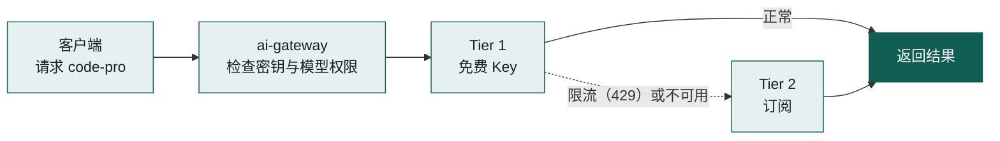
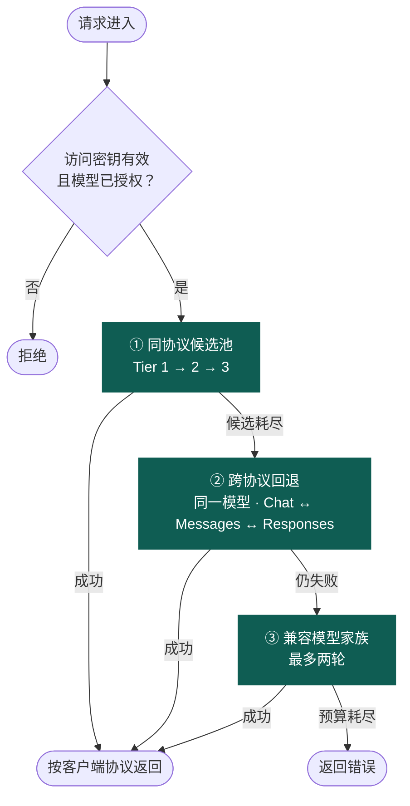

<div align="center">

# ai-gateway

基于 Cloudflare Workers 的高韧性 AI API 网关，将分散在各 Provider、API Key、额度与模型别名上的容量，聚合为一个统一的 OpenAI / Anthropic 兼容入口。

[](https://github.com/fongap-labs/ai-gateway/actions/workflows/ci.yml)
[](LICENSE)


[快速开始](#快速开始) · [贡献指南](CONTRIBUTING.md) · [安全策略](SECURITY.md)

</div>

<p align="center">
  <a href="https://api.135468.xyz/"></a>
</p>

<p align="center"><sub>上图为维护者真实生产实例的近实时数据，由网关自身渲染。</sub></p>

> 新手请从 **这是什么** 读到 **快速开始**。维护者可直接跳到 [参与贡献](#参与贡献)。

## 这是什么

ai-gateway 是一个**私有**的 AI API 网关，运行在 Cloudflare Workers 上。这里的"私有"指自托管、仅供你自己或可信的小团队使用。你把手里分散的模型容量接进来，客户端只需要记住一个地址和一把网关密钥。

- **自动切换**：一路额度用完或被限流，请求会转到下一路。
- **密钥隔离**：客户端只拿到网关密钥，上游 Key 保存在 Cloudflare Secret 中。
- **按分组授权**：每把网关密钥只能调用你为它配置的模型。

| 适合 | 不适合 |
| --- | --- |
| 手里有多个免费额度或多把 Key，想统一调用 | 公共 SaaS、对外售卖 API |
| 个人或小团队自托管，想同时控制成本与稳定性 | 计费、转售、按用户计量 |
| 同时使用 OpenAI 与 Anthropic 协议的客户端 | 企业级组织、RBAC、多租户 |

## 一个例子

假设你有一把免费 Key（Tier 1）和一个 Claude 订阅（Tier 2），客户端请求逻辑模型 `code-pro`：



免费 Key 被限流（429）时，网关会暂时冷却它，改用订阅；冷却到期后再单次探测恢复。在输出开始之前，客户端不需要知道切换发生过。

## 快速开始

### 1. 准备工作

- [ ] **Node.js ≥ 22.18.0**（以 `package.json` 为准，`node -v` 可检查）
- [ ] **Cloudflare 账户**，并已在控制台创建一个 KV 命名空间，记下它的 32 位十六进制 ID
- [ ] **至少一个上游 Key 或订阅**，以及对应的节点配置 JSON 和凭据 JSON
- [ ] **至少一个访问分组**：一把网关密钥，加上该分组允许调用的逻辑模型列表（`AIG_ACCESS_MODELS_*`，必填）
- [ ] **部署后的 `https://` 公网地址**，安装时需要填写

> **费用**：部署会使用你的 Cloudflare 账户（如 Workers、KV），是否产生费用取决于你的 Cloudflare 计划，请以其当前计费为准。网关按 Tier 1 → 2 → 3 的顺序使用容量，Tier 3 是按量计费的付费 API，只在前两层不可用或耗尽时才会被使用。Tier 2 订阅请按各服务商的订阅条款使用。

### 2. 获取代码并部署

在终端中依次运行（每行一步）：

```bash
git clone https://github.com/fongap-labs/ai-gateway.git
cd ai-gateway
npm ci                        # 安装依赖，严格按锁文件版本
npm run cf:login              # 首次需要登录 Cloudflare
npm run config:check -- --tier1 <tier1.json> --secrets <secrets.json>  # 校验节点配置
npm run deploy                # 部署到 Cloudflare Workers
```

部署前需要准备：

| 步骤 | 你需要提供 | 说明 |
| --- | --- | --- |
| 1 | Worker 名称 | 直接使用 `wrangler.jsonc` 默认值，或在 `wrangler.user.jsonc` 中覆盖 |
| 2 | KV 命名空间 ID | 先在 Cloudflare 控制台创建 KV 命名空间，复制它的 ID，写入 `wrangler.user.jsonc` 的 `kv_namespaces` |
| 3 | 节点配置文件（JSON） | Tier 1 必填，Tier 2、3 可留空；可参考 [`config/tier1-nodes.example.json`](config/tier1-nodes.example.json) |
| 4 | 节点凭据文件（JSON） | 必填。形如 `{ "节点 id": "上游 Key" }`，只保存在本机，不要提交到 Git |
| 5 | 网关访问密钥与模型列表 | 每个分组一把密钥（至少一组），并为该分组填写 `AIG_ACCESS_MODELS_*` 模型列表（CSV，必填）。密钥生成方式：`node -e 'console.log(require("crypto").randomBytes(32).toString("base64"))'` |
| 6 | 网关公网地址 | `https://` 开头，用于 OAuth 与仪表盘 |

`npm run deploy` 会执行 `npm run validate:merge` 完整校验，耗时可能较长。订阅 token 的加密密钥需手动生成并作为 Secret 配置。

### 3. 验证部署

```bash
curl https://<你的网关>/health -H "Authorization: Bearer <YOUR_MAX_OR_ULTRA_KEY>"
curl https://<你的网关>/v1/models -H "Authorization: Bearer <YOUR_GATEWAY_KEY>"
```

预期结果：

- `/health` 默认只允许 MAX 与 ULTRA 分组的密钥读取（其他分组返回 `403`，见下文 `AIG_DIAGNOSTICS_GROUPS`）。它返回 JSON，包含 `build`（部署的 commit SHA）、`status`、`ready`、`nodes_usable` 等字段。返回 `200` 表示配置有效；返回 `503` 表示配置无效或未配置，见[故障排查](docs/operations/troubleshooting.md)。`nodes_usable` 应大于 0。
- `/v1/models` 返回非空的模型列表，说明分组配置正确。若为空，见下方[常见问题](#常见问题)。

### 4. 接入客户端

把客户端的 base URL 指向网关，密钥换成网关访问密钥。模型名使用**逻辑模型名**（如 `code-pro`），不是上游的真实模型名。

```bash
# OpenAI 协议（Chat Completions / Responses）
OPENAI_BASE_URL=https://<你的网关>/v1
OPENAI_API_KEY=<YOUR_GATEWAY_KEY>

# Anthropic 协议（Messages，例如 Claude Code）
ANTHROPIC_BASE_URL=https://<你的网关>
ANTHROPIC_AUTH_TOKEN=<YOUR_GATEWAY_KEY>
```

仪表盘首页（`/`）的快速开始区域会按你的分组生成同样的配置。

### 常见问题

- **安装脚本报 Node 版本不对**：Node.js 需要 ≥ 22.18.0，用 `node -v` 检查。
- **KV 命名空间 ID 被拒绝**：ID 必须是 32 位十六进制字符串。
- **`/v1/models` 列表为空**：该分组的 `AIG_ACCESS_MODELS_*` 没有配置，见下面的[配置](#配置)。
- **返回鉴权失败**：确认请求头是 `Authorization: Bearer <密钥>`，且与安装时填写的密钥一致。
- **其他问题**：见 [故障排查](docs/operations/troubleshooting.md)。

## 配置

节点与访问控制由下面四类变量决定：

| 变量 | 作用 | 存放位置 |
| --- | --- | --- |
| `AIG_TIER{1,2,3}_NODES_01..10` | 节点定义：provider、地址、模型映射 | 普通变量 |
| `AIG_TIER{1,2,3}_CREDENTIALS_01..10` | 上游凭据，按节点 id 绑定 | Secret |
| `AIG_ACCESS_KEY_{AIR,PRO,MAX,ULTRA,AGENT}` | 网关访问密钥 | Secret |
| `AIG_ACCESS_MODELS_{AIR,PRO,MAX,ULTRA,AGENT}` | 该分组允许调用的逻辑模型 | 普通变量 |

`01..10` 只是分片编号。配置分片与凭据分片彼此独立（independent），凭据按 **Tier + node id** 绑定到节点，不按相同的后缀对应。

- 五个访问分组互不继承；模型列表为空，该分组就**不能调用任何模型**。
- 凭据绝不写入节点配置。

其他行为开关（例如仪表盘是否公开、订阅开关、限流与回退参数）不在上表中，见[配置文档](docs/operations/configuration.md)。示例文件位于 [`config/`](config/) 目录，不含真实凭据。节点格式、Tier 2 订阅接入与完整变量清单同样见配置文档。

## 进阶：ai-gateway 如何工作

### 容量分层

请求按 Tier 顺序使用容量：Tier 1 耗尽或不可用才看 Tier 2，Tier 2 之后才是 Tier 3。

| Tier | 容量类型 | 角色 |
| --- | --- | --- |
| **Tier 1** | 免费或近似免费的 API 容量 | 日常主力，重点保证韧性与持续可用 |
| **Tier 2** | 订阅权益（Claude Pro/Max、ChatGPT/Codex、Google One AI Premium，经 OAuth 接入） | 次级容量，不是第二个通用 Key 池 |
| **Tier 3** | 付费 API 容量 | 受保护的最终兜底，用量可预测 |

### 请求如何流转



三步共享同一个 `max_attempts`（请求级硬上限）与时间预算。`/v1/responses` 优先原生路径，候选耗尽后同样参与第 ② 步的跨协议翻译。

### 支持的协议与可靠性

| 能力 | 当前行为 |
| --- | --- |
| 协议 | OpenAI Chat Completions、OpenAI Responses、Anthropic Messages；三者通过规范化 IR 矩阵两两互转（六条有向路径） |
| 限流与故障 | 429 自适应冷却后单次探测恢复；模型 404 只隔离失败的映射 |
| 重试与回退 | 所有尝试共享一套预算，`max_attempts` 为硬上限；流式输出开始后不再切换上游 |

- **Tier**：容量层级，见上表。
- **节点（Node）**：一个上游账号或端点的配置单元。
- **逻辑模型**：客户端使用的模型名（如 `code-pro`），映射到各节点的真实上游模型名。
- **访问分组**：`AIR`、`PRO`、`MAX`、`ULTRA`、`AGENT` 之一，决定网关密钥可调用的逻辑模型。
- **原生（Native）**：与客户端同协议的上游路径，是首选。

更多术语见 [术语速查](docs/README.md#术语速查)。

## 文档

| 想了解 | 去这里 |
| --- | --- |
| 架构、请求流程与模块职责 | [架构概览](docs/architecture/overview.md) |
| 路由、冷却与协议细节 | [路由模型](docs/architecture/routing-model.md) · [可靠性模型](docs/architecture/reliability-model.md) · [协议模型](docs/architecture/protocol-model.md) |
| 配置、订阅与变量清单 | [配置](docs/operations/configuration.md) |
| 部署、回滚与故障排查 | [部署](docs/operations/deployment.md) · [故障排查](docs/operations/troubleshooting.md) |
| 产品边界与治理规则 | [产品策略](docs/governance/product-policy.md) · [治理索引](docs/governance/README.md) |

所有文档的入口见 [docs/README.md](docs/README.md)。

## 仓库结构

| 目录 | 内容 |
| --- | --- |
| `src/` | Cloudflare Worker 运行时：配置、调度、可靠性、协议与转换、流式、订阅、可观测性、仪表盘 |
| `scripts/` | 安装、配置检查、部署与校验工具，入口见 [scripts/README.md](scripts/README.md) |
| `config/` | 配置示例，不含真实凭据 |
| `migrations/` | 有序的 D1 迁移，顺序与不可变性属于部署契约 |
| `docs/` | 长期有效的架构、运营与治理文档 |
| `.github/` | CI 分发、PR 治理与模板 |

## 参与贡献

完整规则见 [CONTRIBUTING.md](CONTRIBUTING.md)，要点如下：

- 人类文档与 CHANGELOG 条目使用中文；PR 标题与工程 diff 使用英文。
- 分支使用 `feat/`、`fix/`、`docs/` 等前缀，每个 PR 只有一个主要目标。
- PR 标题遵循 Conventional Commits，例如 `docs: state independent shard binding in README`。
- 行为、配置、协议或部署变化，必须在同一 PR 中更新规范文档。
- PR 描述按 `.github/pull_request_template.md` 填写，合并只用 Squash merge。

### 本地检查

| 命令 | 作用 |
| --- | --- |
| `npm run validate:merge` | 合并前的本地门禁：语法、部署配置、迁移、密钥扫描、文档与链接、lint、类型检查 |
| `npm run check:deploy` | Worker 产物的 dry-run，不部署到生产 |
| `npm test` | 运行测试包；会从 action-worker 拉取固定版本，需要能访问 GitHub |

测试套件不在本仓库中，位于 [fongap-labs/action-worker](https://github.com/fongap-labs/action-worker)。生产部署流程（合并门禁、中央 CI、自动部署与回滚）见 [部署文档](docs/operations/deployment.md)。

## 安全

请不要在公开 Issue 中披露漏洞。使用 GitHub 私密报告：**Security → Report a vulnerability**。

- 上游凭据只存于 Cloudflare Secret，不写入节点配置、日志或诊断输出。
- 网关密钥通过 `Authorization: Bearer` 或 `x-api-key` 头传递，不要放进 URL。
- `/health`、`/metrics` 与 `/v1/*` 需要有效的网关密钥。`/health` 与 `/metrics` 会暴露节点状态与部署版本，默认只允许 MAX 与 ULTRA 分组读取；用 `AIG_DIAGNOSTICS_GROUPS`（逗号分隔，例如 `ULTRA` 或 `MAX,AGENT`）改为其他分组，设为 `*` 则所有有效密钥都可读取。部署后的自动健康检查会选用一个允许读取的分组密钥；已配置的密钥中没有任何一个允许读取时，部署预检会直接失败。
- 仪表盘 `/` 与徽章 `/readme-status.svg` **默认公开**（`AIG_PUBLIC_DASHBOARD` 默认为 `true`），徽章包含本实例的用量统计。仪表盘不列出访问密钥分组名。不希望公开时，将其设为 `false`。

完整规则与限流边界见 [SECURITY.md](SECURITY.md)。

## 许可

Apache License 2.0，详见 [LICENSE](LICENSE)。
