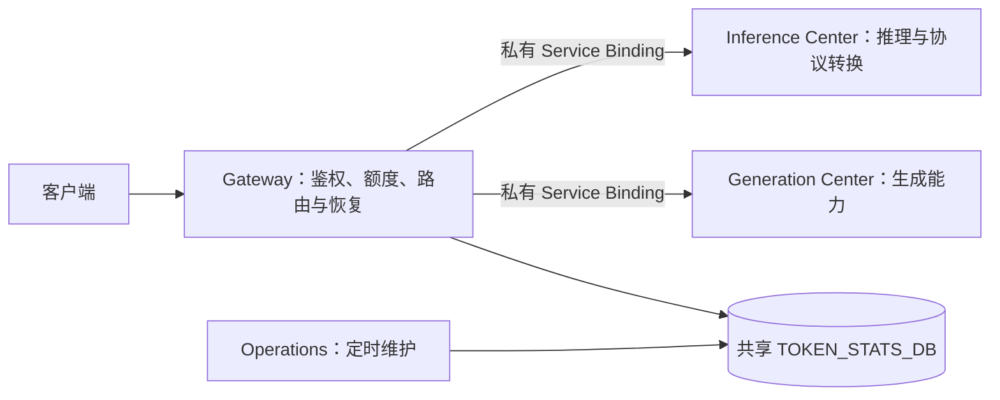

# 四 Worker 能力边界

## 当前状态

本页定义仓库当前的四 Worker 职责。它说明源码和离线合同，不代表 Cloudflare 生产切换已完成；生产资源状态须由受保护的只读盘点及独立运行时证据确认。`.github/deploy.json` 的 `automatic:false` 必须保持，源码合并或 Mock 通过不得标记为生产上线。

| Worker | 职责与边界 |
| --- | --- |
| Gateway | 唯一公开 API 入口；鉴权、模型授权、额度准入、两层调度、限流与故障恢复。通过私有 Service Binding 调用执行中心，不直接执行 Provider 请求。 |
| Inference Center | 私有推理执行、Provider 协议适配、推理协议转换与响应流处理；只持有推理所需 Provider 凭据。 |
| Generation Center | 私有生成能力执行与结果归一化；只持有生成所需 Provider 凭据。 |
| Operations | 独立定时维护入口；使用与 Gateway 相同的 `TOKEN_STATS_DB`，不提供公开 `fetch` 路由且不持有 Provider 凭据。Cron 所有权按受控交接计划变更。 |

当前运行时固定为 Tier 1 免费 API Key → Tier 2 API Token；无旧会员 OAuth 执行，也无 Tier 3。当前架构不包含独立感知 Worker；若未来加入能力，须先有真实消费路径、私有边界和合同测试。

## 拓扑与数据边界



Gateway 的 `TIER1_AFFINITY` KV 是独立 Tier 1 调度状态；它不能替代共享 D1。Inference、Generation 和 Operations 不应配置 Gateway 公网域名。模型 ID 和节点映射是配置数据，源码与文档示例应使用占位值，不应固化运营者的模型别名。

网关必须保留零信任边界、路由决策及其所需的**最小请求元数据**。对于现有 JSON 接口，提取 `model` 可能仍需有界解析；“原样透传”不等于跳过大小限制、认证、权限或基本有效性校验。避免在网关中对大图像、音视频 Base64 内容做完整解析/重新序列化；大型文件采用能力中心直传或授权的对象存储方案，并明确客户端兼容性。

## 内部执行契约

网关每次仅向一个中心发起一个明确的**物理尝试**，由网关拥有后续故障转移。中心不得自行扩展成无界重试、跨节点轮询或请求级模型家族回退。

```http
POST /internal/execute HTTP/1.1
x-aig-contract-version: 1
x-aig-request-id: <gateway-generated-id>
x-aig-node-id: <approved-node-id>
x-aig-model: <authorized-logical-model>
x-aig-surface: chat_completions
x-aig-deadline-ms: <precommit-deadline>
x-aig-inference-auth: <deployment-secret>
content-type: application/json

<original-client-body-or-minimally-rewritten-body>
```

- 上述 `x-aig-*` 头全部由网关重新生成；**不得**透传客户端同名头。
- 内部票据最少包含：契约版本、请求 ID、选定中心、节点 ID、经授权的逻辑模型、客户端 surface、截止时间和是否允许流式输出。中心验证所有字段，缺一项即拒绝。
- Service Binding 是当前私有传输的访问边界，中心不配置公共路由。迁移到公网可达的私有 HTTPS 时，必须增加双向认证或短期签名票据、防重放与固定目标白名单；绝不能只信任头名。
- 上游静态 API Token 及内部 URL 只在中心读取。网关不得把客户端 Authorization、Cookie 或 X-API-Key 传给中心或上游，也不得将中心内部凭据加入请求体。
- 内部接口采用标准 Request/Response 与 HTTP 状态、头、ReadableStream，不将 Cloudflare RPC、KV、D1 或 Node 专有对象作为跨服务协议。
- 成功时返回与客户端 surface 一致的响应；失败时按固定分类携带机器可读原因、明确可重试性与有界 `Retry-After`。内部标识及原始错误不得出现在外部响应。
- 中心报告物理上游请求的状态、耗时、额度/用量提示；缺少用量不得捏造 Token。统计通过独立异步通道提交，不得为写 D1 阻塞首字节。

## 调度与流

```text
鉴权与授权 → 有界读取模型元数据 → 选择中心/节点
→ 准入与预算扣留 → 中心执行一次 → 首个有效输出前检查
├─ 可恢复失败：记录节点冷却，按共享预算换节点/模型
├─ 不可恢复失败：安全返回客户端协议错误
└─ 首事件已提交：直接转发流，禁止再次路由或重放请求
```

- 请求只拥有一份 `max_attempts`、墙钟、每层 Tier 和昂贵容量预算；切换中心不得重置。
- Chat / Responses / Messages 的可用转换由能力中心提供，网关只选择可执行的候选路径。转换失败不能误报为可恢复的上游故障。
- 仅对重复执行安全、未提交的尝试允许故障转移；非幂等生成任务及已经被上游接受的图片/视频任务不盲目重试。采用受控的任务 ID、幂等键和状态查询。
- 首个有意义的 SSE 事件之前允许切换，之后不得透明重试；守卫仅需有界前缀检测，不要全流缓存、整流反序列化或逐 token 重写。
- WebSocket、音频实时流与视频任务若尚无明确协议和执行能力，应拒绝并报告未实现，不能伪装成普通聊天流。

## 模型与额度

- 请求按 Tier 1 免费 API Key → Tier 2 静态 API Token 有界回退；Tier 2 是终点，不存在会员 OAuth 额度或隐式 Tier 3。旧 Tier 3 配置在预检中必须显式迁移。
- 模型资格与回退候选由当前模型目录和 Gateway 有界策略共同决定；只使用目录中已配置的逻辑模型 ID。变更候选关系时需通过配置迁移预检和请求合同测试，不把运营者模型别名写入文档或代码。
- 额度来源包含运营者硬配置、上游可信的窗口信号及 429 冷却；未知额度不得当成无限或确定的 0。
- isolate 本地计数与 KV 提示**不是全局硬限流**。若未来需要跨中心、跨隔离实例的严格原子额度，先给出成本与负载证据，再使用独立的原子协调机制，不在热路径对每条流写 D1。
- 不能因为某一中心、账号或仓库失效而停止其他独立中心/节点；按失败域隔离。

## 实现语言

- Rust 核心继续拥有其既定核心逻辑；TypeScript Worker 负责 Cloudflare 接入、服务适配与运行工具，不重复实现核心算法。
- Gateway、Inference、Generation、Operations 的 Worker 入口和 TypeScript 运维脚本保持现有 TypeScript 边界。
- 跨 Worker 服务调用继续使用明确的 HTTP/Request/Response/Streams 合同；语言边界不改变凭据归属、重试预算或失败语义。

## 禁止事项

- 不让主 Worker 继续执行 Provider 大型转换矩阵、图片编码、视频任务或逐事件用量汇总；会员 OAuth 授权与刷新逻辑不得恢复。
- 不建立额外的模型授权权威或第二套请求级故障转移。
- 不自动降级密钥权限或回退到个人 Token；缺失专用凭据时失败即关闭。
- 不为拆分而增加独立公网入口、总线、数据库、Runner 或复杂消息编排。
- 不在新旧路径间长期双写/双读；切换时按完整部署单元更换，由不可变 Git SHA 与冻结分支支持回滚。
